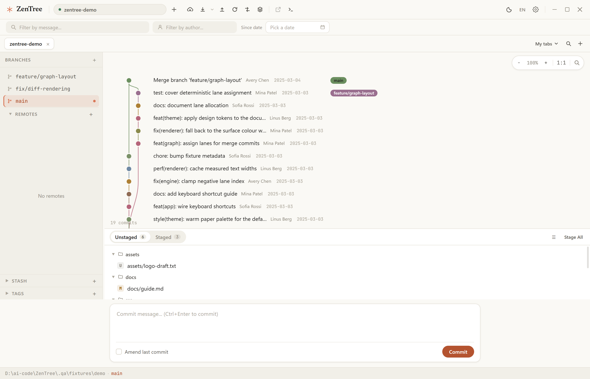
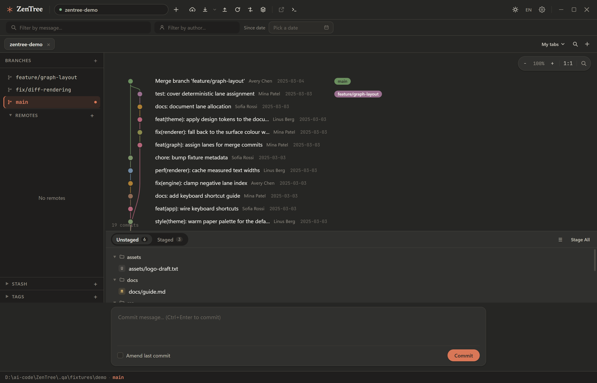
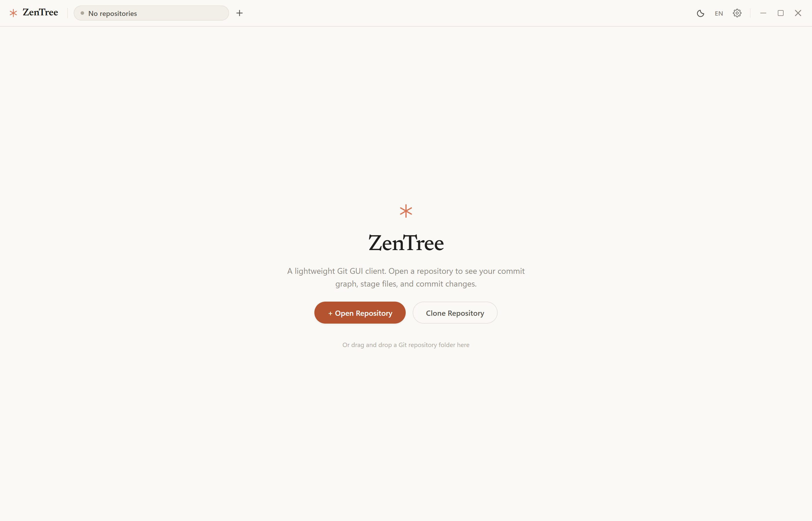
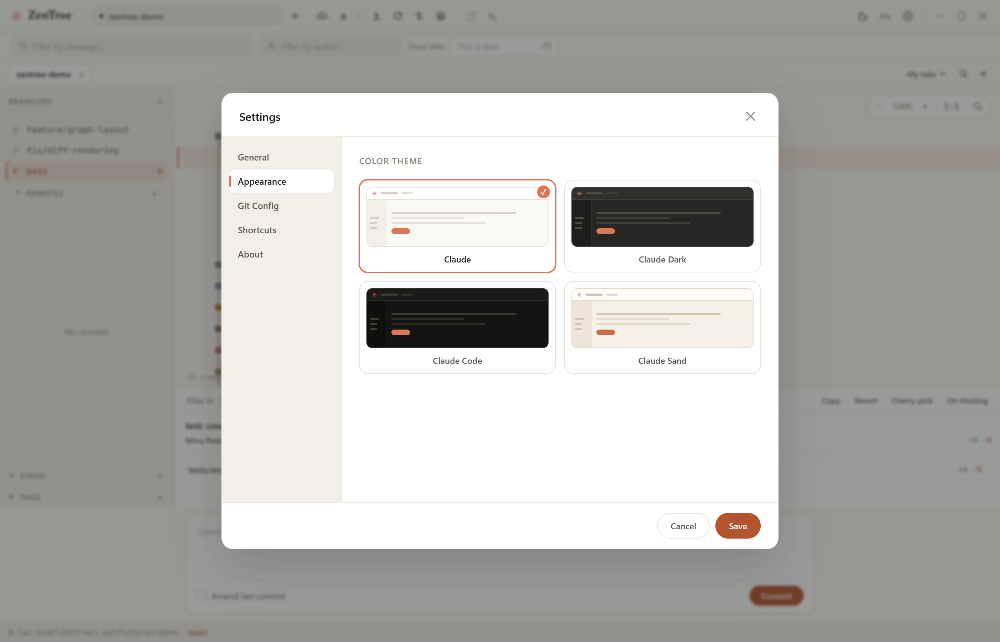

# ZenTree

A lightweight, modern Git GUI client built with Electron + React + TypeScript. It brings the
core SourceTree workflow — commit graph, staging, diffing — into a fast, calm desktop app with
a visual language inspired by the Claude desktop and Claude Code apps.

[中文文档](README_zh.md) · [Design system](docs/design-spec.md) · [Verification record](docs/verification-1.4.0.md) · [Changelog](CHANGELOG.md)

## Screenshots

| Claude (default light) | Claude Dark |
|---|---|
|  |  |

| Welcome | Settings · themes |
|---|---|
|  |  |

## Highlights

### Design

- **Claude-inspired visual system** — warm paper surfaces, hairline borders, a single terracotta
  accent, generous spacing, and low-chrome controls (see `docs/design-spec.md`)
- **4 themes** — Claude (default light), Claude Dark, Claude Code (deep terminal dark), Claude Sand
- **Bundled typefaces** — Newsreader (display serif), JetBrains Mono (hashes, diffs, numbers), both
  OFL-licensed and shipped with the app; no network fonts
- **Frameless window** — custom title bar, tab strip, and window controls drawn in the theme

### Git workflow

- **Commit graph** — HTML5 Canvas DAG with smooth branch lanes, branch-ref pills, hover/selection
  states, zoom, in-graph search, viewport culling and infinite scroll (10,000+ commits)
- **Staging & diffs** — file panel with staged/unstaged/commit-file views, file tree or flat mode,
  syntax-highlighted side-by-side diff, per-hunk stage/unstage/revert (including added, deleted and
  renamed files), word-level diff marks
- **Commit composer** — floating Claude-style composer with draft protection, amend support,
  commit template prefill and `Ctrl+Enter` to commit
- **Three-column layout** — sidebar (branches / remotes / tags / stash) · graph + files · diff panel
- **Repository tabs** — one tab per repository, drag to reorder, `Ctrl+P` picker, `Ctrl+Tab` cycling;
  a repo group can be shown as the tab set; per-repository cache paints instantly on switch
- **Command palette** (`Ctrl+K`) — jump to repositories, branches, or run commands
- **History tools** — file history (follows renames), blame with commit jump, compare two refs with
  ahead/behind stats, revert / cherry-pick / interactive rebase, reset (soft/mixed/hard)
- **Conflicts** — built-in three-way merge panel (take ours/theirs/both), with external mergetool
  fallback for binary or oversized files
- **Remote work** — fetch/pull/push, pull strategies (merge/rebase/ff-only), upstream tracking with
  ahead/behind badges, remote branch checkout, prune, tag and remote management
- **Extras** — clone, submodules, per-repo commit template, GPG-sign toggle, external diff tool,
  hosting links (GitHub/GitLab/Bitbucket), Git Bash launcher
- **i18n** — full English and Simplified Chinese dictionaries (`en` / `zh`) with key/placeholder parity tests
- **Refresh** — `fs.watch` on git metadata (HEAD / index / refs, including linked worktrees) drives
  debounced silent refreshes; a cheap fingerprint poll (30 s + window focus) covers working-tree
  edits and acts as a fallback
- **Auto update** — checks GitHub Releases from Settings → About (installer builds only)

### Engineering

- **Hardened IPC** — context isolation, sandboxed renderer, no Node integration; every mutating git
  channel validates the repository path; renderer URLs are http(s)-allow-listed before opening
- **Path confinement** — working-tree reads/writes reject traversal, absolute paths, symlinks and
  `.git` metadata
- **Single instance** — a second launch focuses the existing window instead of racing the settings file
- **Typed contracts** — one `GitAPI` interface shared by main process, preload bridge and renderer;
  renderer, main-process and test suites are all type-checked in `npm run check`
- **Test suite** — 504 Vitest tests including real-git integration suites in isolated temp repos
  with a hermetic git environment (see [Testing](#testing))
- **Visual QA tooling** — Electron screenshot matrix, demo fixtures and a class-name/style coverage
  checker (`npm run qa`)

## Tech stack

| Layer | Technology |
|---|---|
| Desktop shell | Electron 36 |
| Build tooling | Vite 6 + TypeScript 5.7 |
| UI | React 18 + Zustand 5 |
| Styling | Hand-written CSS design tokens (`src/theme.css` + `src/styles/*.css`) |
| Git backend | simple-git 3.27 |
| Graph rendering | HTML5 Canvas (two layers: graph + interaction overlay) |
| i18n | Tiny dictionary-based `t()` with en/zh parity tests |
| Packaging | electron-builder (NSIS installer + portable exe) |
| Testing | Vitest 4 (+ `@vitest/coverage-v8`), Testing Library, Playwright (Electron screenshots) |

## Installation

Download the latest installer from [Releases](https://github.com/gongshiyun/ZenTree/releases):

- **`ZenTree Setup x.y.z.exe`** — NSIS installer with desktop shortcut
- **`ZenTree x.y.z.exe`** — portable build (no installation)

### System requirements

- Windows 10 or later
- [Git for Windows](https://git-scm.com/download/win) installed and available on `PATH`
  (or set the git binary path in Settings → General)

## Development

### Prerequisites

- **Node.js 18+** and npm
- **Git** — a working `git` binary on `PATH` (required by the app and by the integration tests)

```powershell
git clone https://github.com/your-org/ZenTree.git
cd ZenTree

npm install

# Dev server (Vite HMR + Electron)
npm run dev

# Full pre-commit gate: renderer + main + tests type-checking and the test suite
npm run check

# Production build
npm run build

# Windows installer + portable exe (release/)
npm run pack
```

> On Windows PowerShell, use `npm.cmd` if script execution policy blocks `npm.ps1`.

### Testing

`npm test` runs the Vitest suite. Most suites shell out to a real `git` binary: every test creates an
isolated throw-away repository under the OS temp directory and removes it afterwards. The suite is
hermetic — `tests/setup.ts` points git at a temporary `HOME`/`GIT_CONFIG_GLOBAL`, disables the system
config and sets `GIT_CONFIG_NOSYSTEM` / `GIT_TERMINAL_PROMPT`, so a developer's global git config
(hooks, signing, identity) cannot change results.

| Suite | Scope | Real git |
|---|---|---|
| `tests/domain.test.ts`, `tests/parserEdge.test.ts`, `tests/highlight.test.ts`, `tests/graph.test.ts` | Pure logic: diff parsing/highlighting/word-diff, hunk patches, graph layout, conflict markers, fingerprints | No |
| `tests/repoStore.test.ts` | Application store transitions, per-repo caching, refresh races, settings restore | No |
| `tests/ipc.test.ts` | IPC envelope contract, destructive channels, argument validation | Yes — temp repos |
| `tests/gitRepository.test.ts` | `GitRepository` adapter end-to-end (checkout, rebase, stash, submodules, compare, worktrees, …) | Yes — temp repos |
| `tests/*.test.tsx` | Component tests in jsdom (canvas is stubbed) | No |
| `tests/watcher.test.ts`, `tests/windowManager.test.ts`, `tests/updateManager.test.ts`, … | Infrastructure adapters with fakes | Partly |

Extra gates:

```powershell
npm run test:coverage   # v8 coverage report
npm run qa:css          # every className used in TSX has a rule in src/theme.css or src/styles/*.css
npm run qa:fixture      # build deterministic demo repositories under .qa/fixtures
npm run qa:shots        # launch Electron and capture the UI screenshot matrix under .qa/shots
```

## Project structure

```
ZenTree/
├── electron/                  # Main process (infrastructure layer)
│   ├── main.ts                # composition root: settings/git/window/ipc/updater/watcher
│   ├── windowManager.ts       # frameless window, theme background, navigation guards
│   ├── settingsRepository.ts  # validated JSON settings persistence
│   ├── gitRepository.ts       # simple-git adapter + Git Bash discovery
│   ├── ipc.ts                 # IPC channels (validation + error envelopes)
│   ├── preload.ts             # contextBridge preload (shares the GitAPI contract)
│   ├── watcher.ts             # fs.watch on git metadata (worktree-aware, debounced)
│   └── updateManager.ts       # electron-updater state machine
├── src/
│   ├── domain/                # Pure logic: graph layout/colors, diff parse/highlight/
│   │                          # word-diff/conflict markers, file tree, fingerprints,
│   │                          # tabs, theme presets
│   ├── application/           # Zustand store (state + use-case orchestration)
│   ├── infrastructure/        # renderer-side git bridge gateway
│   ├── components/            # React UI
│   ├── renderer/              # dual-canvas commit graph engine
│   ├── styles/                # shell.css · panels.css · dialogs.css
│   ├── assets/fonts/          # bundled OFL fonts (Newsreader, JetBrains Mono)
│   ├── i18n/                  # en / zh dictionaries
│   ├── theme.css              # design tokens + global base styles
│   └── types/                 # shared cross-layer contracts
├── scripts/                   # QA tooling (fixtures, screenshots, CSS coverage)
├── tests/                     # Vitest suites (+ hermetic git setup)
├── docs/                      # design spec, review findings, screenshots
└── CHANGELOG.md
```

## License

MIT. Bundled fonts are licensed under the SIL Open Font License (see `src/assets/fonts/LICENSE-*`).

---

Built with ❤️ using Electron, React, and Canvas.
